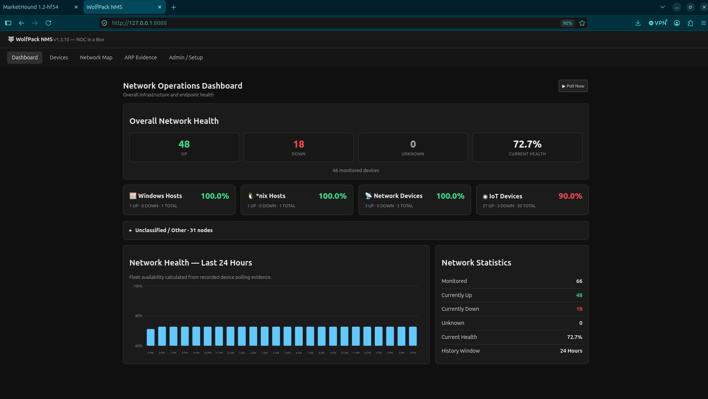
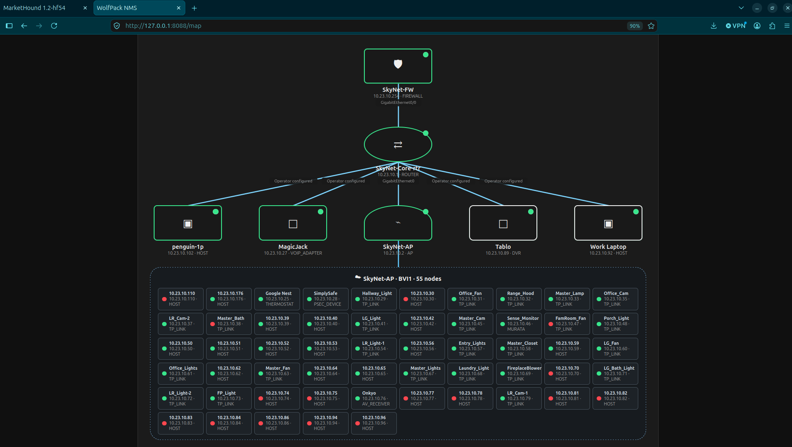

# WolfPack NMS

**WolfPack NMS** is a lightweight, evidence-oriented network monitoring system for homelabs, small networks, NOC labs, and infrastructure engineering. It combines device discovery, configurable health polling, topology/adjacency evidence, ARP observations, interface inventory, synthetic checks, a 24-hour health dashboard, and stateful email alerting in a compact Flask/SQLite application.

Current release: **1.3.11**

> WolfPack doctrine: observe, preserve the evidence, and alert on meaningful state changes — not every polling cycle.

## Highlights

- Network discovery with a `/22` safety limit per discovery request.
- Device inventory with hostname/display name, platform classification, vendor/model, location, notes, and management metadata.
- Per-device health polling using **ICMP**, **TCP**, or **ARP**.
- Optional ARP fallback for same-segment Layer-2 presence detection.
- 24-hour fleet-health chart with fixed hourly slots and recorded polling evidence.
- SSH-based collection for supported network devices.
- Interface inventory and operator/evidence-driven topology relationships.
- ARP evidence table with observer context.
- Synthetic ICMP, DNS, TCP, HTTP, and HTTPS checks.
- Stateful email alerting with a configurable alert group.
- **One DOWN notification and one CLEAR notification** per outage transition; unchanged states remain silent.
- Generic authenticated SMTP support with optional STARTTLS.
- Web-based ZIP lifecycle updater with backup, health check, and rollback behavior.
- SQLite evidence store using WAL mode and a busy timeout for concurrent access.
- JSON health and device APIs.

## Screenshots

### Network Operations Dashboard



The dashboard provides current fleet health, platform rollups, a 24-hour evidence-backed availability view, and network statistics at a glance.

### Network Map



The map visualizes operator/evidence-driven relationships from the firewall and core through infrastructure and attached endpoints, with current device state shown directly on the topology.

> **Example environment:** The screenshots above are from the project's real SkyNet home/lab environment. RFC 1918 addresses, lab device names, and topology shown are examples of the environment in which WolfPack NMS is developed and tested; they are not required naming or addressing conventions.

## Intended use, support, and expectations

WolfPack NMS was built because the Evidence Engineering team needed a lightweight NMS for its own **SkyNet home/lab environment**. The team normally builds evidence-oriented network tools for discovery, interrogation, inventory, experimentation, and analysis; NMS grew from that same practical approach: we needed it, so we built it.

WolfPack NMS is intended for **home, homelab, educational, and experimental use**. It has been developed and validated against the maintainers' own environment and requirements. Other networks can differ substantially in scale, topology, routing, segmentation, device behavior, security controls, protocol availability, and failure modes. A configuration that has not been tested here should not be assumed to be supported merely because it appears technically possible.

**Your mileage may vary.** The software is provided as-is, without guarantees of functionality, scalability, availability, accuracy, reliability, compatibility, security, fitness for a particular purpose, or continued development. Do not use WolfPack NMS as the sole monitoring or alerting mechanism for safety-critical, life-safety, production-critical, or other high-consequence systems.

**No technical support, deployment assistance, compatibility testing, SLA, or operational support is offered.** GitHub issues and pull requests may be reviewed at the maintainers' discretion, but there is no guarantee of response, resolution, implementation, or continued compatibility. Operators are responsible for evaluating, configuring, securing, validating, backing up, troubleshooting, and operating their own installations.

### RTFM

Before declaring something broken: **RTFM — Read The Fine Manual.** Read this README and **[HOWTO.md](HOWTO.md)**, inspect the application logs and recorded evidence, verify the configuration, and reproduce the problem where practical. GitHub issues are appropriate for useful, reproducible defect reports; they are **not a technical-support queue**.

Experiment. Inspect the evidence. Read the source. Modify it for your lab. Have fun.

## Screens and workflows

The web UI exposes five primary areas:

| Area | Purpose |
|---|---|
| Dashboard | Current health, platform groups, 24-hour health history, synthetics, and manual polling |
| Devices | Inventory and per-device configuration |
| Network Map | Topology/adjacency visualization and topology collection |
| ARP Evidence | Layer-2 observations attributed to the device that observed them |
| Admin / Setup | Site/polling settings, email alerting, and ZIP updates |

## Architecture

```text
Browser
   |
   v
Waitress :8088
   |
   v
Flask / WolfPack NMS
   |---------------------> Polling engine
   |                         |-- ICMP
   |                         |-- TCP
   |                         |-- ARP
   |                         `-- ARP fallback
   |
   |---------------------> Topology / SSH collection
   |
   |---------------------> Stateful alert engine ----> SMTP relay
   |
   `---------------------> SQLite (wolfpack.db)
                             |-- devices
                             |-- evidence
                             |-- synthetics
                             |-- arp_observations
                             |-- device_interfaces
                             |-- alert_groups
                             `-- active_alerts
```

The database is the local evidence repository. Poll results are recorded before state-transition notification handling is invoked.

## Alerting doctrine

WolfPack NMS alerting is **edge-triggered**:

```text
UP      -> DOWN     send one DOWN email
DOWN    -> DOWN     remain silent
DOWN    -> UP       send one CLEARED email
UP      -> UP       remain silent
UNKNOWN -> DOWN     no startup DOWN email
```

This prevents repeated notifications for a device that remains down. The current v1 implementation provides one configurable alert group, with per-device assignment.

## Quick start

Ubuntu 24.04 is the primary development/deployment target.

```bash
unzip WolfPack-NMS-1.3.11.zip
cd WolfPack-NMS-1.3.11
sudo ./install.sh
```

The installer creates `/opt/wolfpack/nms`, builds a Python virtual environment, installs dependencies, creates `wolfpack-nms.service`, and starts the service.

Open:

```text
http://SERVER-IP:8088
```

Verify from the host:

```bash
curl -fsS http://127.0.0.1:8088/api/health
systemctl status wolfpack-nms --no-pager
```

For complete installation, configuration, alert testing, upgrade, backup, troubleshooting, and operational procedures, see **[HOWTO.md](HOWTO.md)**.

## Polling methods

### ICMP

The default poll method. A successful echo response marks the device UP.

### TCP

Attempts a TCP connection to the configured device port. This is useful when ICMP is intentionally filtered but a specific application/listener represents availability.

### ARP

Uses `arping` on the configured local interface. ARP is Layer 2 and therefore normally useful only for devices on a directly reachable broadcast domain.

### ARP fallback

A device can use ICMP or TCP as its primary method and ARP as a fallback. If the primary method fails but ARP succeeds, WolfPack treats the device as present/UP and records the fallback in evidence.

ARP fallback establishes **Layer-2 presence**, not application health.

## Evidence model

WolfPack records observations rather than relying only on current state. Examples include:

- `POLL-ICMP`
- `POLL-TCP`
- `POLL-ARP`
- SSH authentication/collection evidence
- CLI/interface evidence
- ARP observations
- synthetic results
- `ALERT-EMAIL-DOWN`
- `ALERT-EMAIL-CLEAR`

This makes it possible to distinguish what NMS currently believes from what it actually observed and recorded.

## Email alerts

Configure SMTP under **Admin / Setup -> Email Alerting**. WolfPack supports:

- SMTP host and port
- username/password authentication
- STARTTLS
- From display name
- From address
- recipient list
- alert-group enable/disable
- test email

SMTP providers may restrict the From address to a verified or provider-issued sender. That is a provider policy, not a WolfPack requirement.

Assign the alert group from the individual device configuration page. Devices with no alert group do not generate email notifications.

## APIs

The current build exposes:

```text
GET /api/health
GET /api/devices
GET /api/device/<id>/interfaces
GET /api/device-by-key/interfaces?key=<ip>
GET /api/device/<id>/interface-debug
```

`/api/health` is also used by the lifecycle updater to validate a deployment.

## Repository layout

```text
.
├── README.md
├── HOWTO.md
├── SECURITY.md
├── CONTRIBUTING.md
├── .gitignore
├── install.sh
├── update.sh
├── requirements.txt
├── run.py
└── wolfpack_nms/
    ├── __init__.py
    ├── alerts.py
    ├── db.py
    ├── engine.py
    ├── topology.py
    ├── web.py
    └── templates/
```

## Security status

WolfPack NMS is currently a **trusted-network/lab-oriented project**, not a hardened Internet-facing service. In particular, the current release stores configured SSH, SNMP, and SMTP credentials in the local SQLite database. Run it only on a trusted management network and protect the host/database accordingly.

Before publishing a working tree, verify that `wolfpack.db`, environment files, credentials, logs, backups, virtual environments, and local evidence are not staged. The included `.gitignore` covers the common local artifacts, but it is not a substitute for reviewing `git status` and secret scanning.

See **[SECURITY.md](SECURITY.md)** for the current security model and disclosure guidance.

## Updating

From an installed host, either use **Admin / Setup -> Update From ZIP** or run:

```bash
sudo /opt/wolfpack/nms/update.sh /path/to/release.zip
```

The updater backs up the existing installation, replaces application code, refreshes Python requirements, restarts NMS, checks `/api/health`, and rolls back if the health check fails.

## Development

For a local development instance:

```bash
python3 -m venv .venv
source .venv/bin/activate
pip install -r requirements.txt
export WOLFPACK_NMS_DB="$PWD/dev-wolfpack.db"
python run.py
```

Do not use a production database for development experiments.

## Contributing

See **[CONTRIBUTING.md](CONTRIBUTING.md)**. Keep changes evidence-oriented, preserve upgrade compatibility where practical, and do not commit credentials or operational databases.

## License

**No open-source license has been selected yet.** Until a license is added, copyright remains with the project owner and GitHub publication alone does not grant general rights to copy, modify, or redistribute the software.
